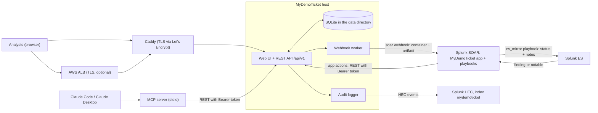

# MyDemoTicket

A small, ServiceNow-like ticketing system built for Splunk SOAR and Splunk
Enterprise Security (ES) demos. Pure Python standard library (Python 3.9+),
SQLite and a vanilla JS web UI: nothing to install, no build step, no CDN.

It comes with a Splunk SOAR app, two SOAR playbooks (ticket ↔ ES mirror),
Splunk configuration and dashboards for the audit log, an MCP server for
Claude Code / Claude Desktop and installers for a Linux server or AWS EC2.

## Features

| Area | What you get |
|---|---|
| Tickets | Number `TKT` + 7 digits (one global sequence), short description, description, priority 1–4, assignment group, assignee, caller, category, close notes |
| States | `new`, `in_progress`, `on_hold`, `resolved`, `closed`, `cancelled` with a checked state machine (`resolved` needs close notes) |
| Journal | Entry types `comment` (visible to the caller), `work_note` (internal), `summary` (AI or resolution summary, visible like a comment) and `audit` (field changes); optional `author` for comments written by an integration on behalf of a person |
| Custom fields | Per tenant: `string`, `number`, `boolean`, `choice`, `date`; four demo fields are seeded |
| Cross references | `external_refs` (e.g. `soar_container_id`, `es_finding_id`, `es_investigation_id`), searchable with `GET /tickets?external_ref.<key>=<value>` |
| Roles | `platform_admin`, `admin`, `agent`, `integration`, `requester` |
| Teams | Per tenant, used for assignment and agent permissions |
| Tenants | One database, strict per-tenant isolation; default tenant `soc-games` |
| Reports | `GET /api/v1/reports/summary` (counts by state, priority, team, MTTR) and a Reports page in the UI |
| Audit | Every action and every `401`/`403` to `<data-dir>/logs/audit.log`, optionally to Splunk HEC (sourcetype `mydemoticket:audit`) |
| Webhooks | Type `generic` (HMAC-signed JSON) and type `soar` (creates a SOAR container + artifact per event), with loop protection |
| SOAR app | 10 actions incl. `on poll` (`soar-app/`) |
| SOAR playbooks | `mydemoticket_es_mirror` (ticket → ES status and notes), `mydemoticket_ticket_from_es` (ES notable → ticket) (`soar-playbooks/`) |
| MCP server | Claude Code / Claude Desktop tools for tickets, journals, reports (`mcp-server/`) |
| Web UI | Ticket list and filters, ticket detail with tabs (Work notes, Comments, Resolution report, Audit trail, History), admin pages for users, teams, custom fields, webhooks, audit status and tenants |

## Architecture



Details, sequence diagram and data model: [docs/architecture.md](docs/architecture.md).

## Repository layout

```
ticket-system/mydemoticket/   server: api, auth, db, tenants, audit, webhooks, server, static/ (web UI)
ticket-system/tests/          unittest suite (real server on a random port, temp data dir)
soar-app/                     Splunk SOAR app (build.py -> soar-app/dist/mydemoticket.tgz)
soar-playbooks/               SOAR playbooks: ES mirror and ticket-from-ES
mcp-server/                   MCP server for Claude Code / Claude Desktop (stdio)
splunk/                       props/fields/indexes/inputs/authorize examples, dashboards/
deploy/                       install.sh (systemd + Caddy), templates, aws/ (EC2 deploy, boot, backup)
tests/e2e/, scripts/e2e.sh    end-to-end tests ticket system <-> SOAR app (mocked SOAR)
docs/                         architecture, installation, operations, API, logging, mockups
```

## 5-minute quick start (local)

Needs only Python 3.9 or newer. Pick a free port and a data directory:

```bash
PORT=8080
DATA="$HOME/.mydemoticket"
cd ticket-system
python3 -m mydemoticket --host 127.0.0.1 --port "$PORT" --data-dir "$DATA" &
sleep 2
curl -s "http://127.0.0.1:$PORT/api/v1/health"
# {"status": "ok", "version": "1.0.0"}
```

On the first start the data directory is created with the default tenant
`soc-games`, demo teams (SOC L1, SOC L2, IT Ops), users (`admin` as
`platform_admin`, `analyst1`, `analyst2`, `requester1`, `soar`) and four custom
fields. Passwords and tokens are random and written to
`$DATA/initial-credentials.txt` (mode 0600), never printed.

```bash
TOKEN=$(sed -n 's/^admin API token: //p' "$DATA/initial-credentials.txt")
curl -s -X POST -H "Authorization: Bearer $TOKEN" -H "Content-Type: application/json" \
  -d '{"short_description": "First demo ticket", "priority": 2, "assignment_group": "SOC L1"}' \
  "http://127.0.0.1:$PORT/api/v1/tickets"
curl -s -H "Authorization: Bearer $TOKEN" "http://127.0.0.1:$PORT/api/v1/tickets"
```

Open `http://127.0.0.1:$PORT` in a browser and log in as `admin` with the
password from `initial-credentials.txt`. Stop the server with `kill %1`.

## Documentation

| Document | Content |
|---|---|
| [docs/installation.md](docs/installation.md) | Install locally, on a Linux server or on AWS; configuration reference; connect SOAR, ES, Splunk and the MCP server; verification |
| [docs/operations.md](docs/operations.md) | Backup/restore, updates and schema migrations, moving to a new machine, monitoring, troubleshooting, uninstall |
| [docs/architecture.md](docs/architecture.md) | Components, data flow ticket ↔ SOAR ↔ ES, tenants, roles, schema versions |
| [docs/api.md](docs/api.md) | REST API reference with curl examples |
| [docs/logging.md](docs/logging.md) | Audit event schema, Splunk HEC, tenant separation, dashboards, searches |
| [deploy/README.md](deploy/README.md) | Demo deployment notes (systemd, Caddy, AWS) |
| [soar-app/mydemoticket/README.md](soar-app/mydemoticket/README.md) | SOAR app: asset config, actions, on poll |
| [soar-playbooks/README.md](soar-playbooks/README.md) | SOAR playbooks: logic, constants, known limits |
| [mcp-server/README.md](mcp-server/README.md) | MCP server: token, install, tools |
| [CHANGELOG.md](CHANGELOG.md) | Release history |

## Tests

```bash
cd ticket-system && python3 -m unittest discover -s tests -v > "${TMPDIR:-/tmp}/mdt-tests.txt" 2>&1; tail -3 "${TMPDIR:-/tmp}/mdt-tests.txt"
cd ../mcp-server && python3 -m unittest discover -s tests -v > "${TMPDIR:-/tmp}/mdt-mcp-tests.txt" 2>&1; tail -3 "${TMPDIR:-/tmp}/mdt-mcp-tests.txt"
cd ../soar-app && python3 -m unittest discover -s tests -v > "${TMPDIR:-/tmp}/mdt-soar-tests.txt" 2>&1; tail -3 "${TMPDIR:-/tmp}/mdt-soar-tests.txt"
cd .. && bash deploy/tests/test_deploy_scripts.sh
bash scripts/e2e.sh 3 > "${TMPDIR:-/tmp}/mdt-e2e.txt" 2>&1; echo "exit $?"; grep "E2E run" "${TMPDIR:-/tmp}/mdt-e2e.txt"
```

Success for the unittest suites is the line `OK` after `Ran N tests`; the e2e
script prints `E2E run i/N: OK` per run. The e2e suite starts the real server
on 127.0.0.1 and talks to a SOAR mock (`tests/e2e/soar_mock.py`); it does not
cover a real SOAR or ES instance or the browser UI itself.

## Versions

| Component | Version | Where |
|---|---|---|
| Ticket system | 1.0.0 | `ticket-system/mydemoticket/__init__.py` (`GET /api/v1/health`) |
| REST API | v1 | `/api/v1` |
| Database schema | 3 | `PRAGMA user_version`, migrations in `ticket-system/mydemoticket/db.py` |
| SOAR app | 1.2.0 | `soar-app/mydemoticket/mydemoticket.json` (`app_version`) |
| MCP server | 1.0.0 | `mcp-server/mydemoticket_mcp/__init__.py` |

See [CHANGELOG.md](CHANGELOG.md).
