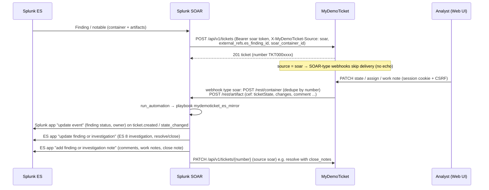
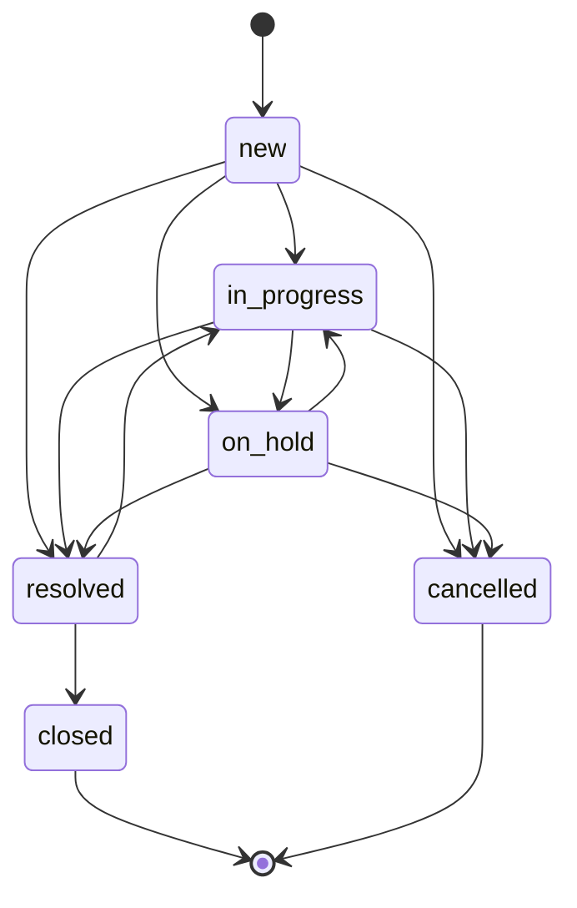

# MyDemoTicket – Architecture

MyDemoTicket is a small, ServiceNow-like ticketing system built for Splunk SOAR
and Splunk Enterprise Security (ES) demos. It runs on the Python standard library
only (Python 3.9+): no third-party packages, no build step, no CDN.

## Components

```
ticket-system/mydemoticket/
  __main__.py   CLI: python3 -m mydemoticket --host --port --data-dir --no-seed --secure-cookies --quiet
  server.py     ThreadingHTTPServer, routing, auth (Bearer / session + CSRF), static files
  api.py        REST handlers: tenants, tickets, journal, custom fields, users, teams, webhooks, reports, audit status
  auth.py       roles, pbkdf2 passwords, sha256 tokens, sessions, tenant context, first-start bootstrap
  tenants.py    tenant lookup, validation, per-tenant seed (teams, custom fields)
  audit.py      audit logger: local JSON log + optional Splunk HEC (see docs/logging.md)
  webhooks.py   background worker for outbound webhooks (generic + SOAR), retry 3x
  db.py         sqlite3 connection, schema + idempotent migrations (PRAGMA user_version)
  static/       single-page web UI (index.html, app.js, app.css)
```

Around the ticket system:

```
soar-app/          Splunk SOAR app "MyDemoTicket" 1.2.0: 10 actions incl. on poll (REST client, stdlib only)
soar-playbooks/    mydemoticket_es_mirror (ticket -> ES), mydemoticket_ticket_from_es (ES notable -> ticket)
mcp-server/        MCP server 1.0.0 (stdio, JSON-RPC 2.0) for Claude Code / Claude Desktop, journal source "mcp"
splunk/            props/fields/indexes/inputs/authorize examples and two Simple XML dashboards
deploy/            install.sh (systemd + Caddy), aws/ (deploy.sh, boot.sh, backup.sh, user-data.sh)
```

| Component | Responsibility | State |
|---|---|---|
| HTTP server | Parses requests, authenticates, dispatches to `Api`, serves UI | none |
| `Api` | Validation, state machine, permissions, journal/audit, emits events | SQLite |
| `WebhookDispatcher` | Queues events, delivers with retry, writes delivery log | SQLite + in-memory queue |
| `AuditLogger` | One audit event per action, request id, never secrets | `<data-dir>/logs/audit.log` + HEC |
| SQLite | Tenants, tickets, journal, users, tokens, sessions, teams, custom fields, webhooks | `<data-dir>/mydemoticket.sqlite3` |

The data directory (`--data-dir`, `$MYDEMOTICKET_DATA_DIR` or `~/.mydemoticket`) holds
the database (WAL mode), the migration backups `*.pre-v<N>.bak`, the audit log
`logs/audit.log` and, after the first start, `initial-credentials.txt` (mode 0600).
Nothing else is written outside it.

## Journal

Every ticket has one chronological journal (`journal` table). Entry types:

| Type | Written by | Visible to the requester |
|---|---|---|
| `comment` | `POST /tickets/{number}/comments` (default type) | yes |
| `work_note` | same, `"type": "work_note"`; not for requesters | no |
| `summary` | same, `"type": "summary"` (AI or resolution summary); not for requesters | yes |
| `audit` | the server, one entry per changed field (and `created`) | yes |

Each entry has `actor` (user of the token or session), `source` (from
`X-MyDemoTicket-Source`, default `api`/`web`) and, since schema v3, an optional
`author`: the real person an integration writes for (e.g. the ES analyst). The UI
shows `jdoe (via soar)`. The ticket detail page shows the journal in tabs: Work
notes, Comments, Resolution report (newest `summary`), Audit trail, History.

## Data flow Ticket ↔ SOAR ↔ ES



ES mirror details (`soar-playbooks/mydemoticket_es_mirror.py`): the target is
`cef.esInvestigationId` (ES 8 investigation GUID) if set, else `cef.esFindingId`.
Status mapping new→1, in_progress→2, on_hold→3, resolved→4, closed/cancelled→5.
Notes are written with the Enterprise Security app (not as `update event`
comments, which ES 8 shows only as a "Finding Update" note) with the content
`MyDemoTicket <number> – <type>/<author>: <text>`. On resolve/close/cancel a close
note with `cef.closeNotes` is added. Artifacts with `cef.source = soar` are ignored.
Without any ES id the playbook only adds a note to the SOAR container.

ASCII overview:

```
 +-----------+   finding    +-------------+   REST (Bearer, source=soar)   +---------------+
 | Splunk ES | -----------> | Splunk SOAR | -----------------------------> | MyDemoTicket  |
 |           | <----------- |  (app +     | <----------------------------- |  REST + UI    |
 +-----------+  status/note |  playbooks) |  webhook: container+artifact   |  SQLite       |
                            +-------------+  or generic signed JSON        +-------+-------+
                                                                                    ^
                                                                    browser (session|CSRF)
                                                                                    |
                                                                             SOC analysts
```

## Sync concept

* **Identity:** the ticket `number` is the stable key. It is used as the SOAR
  container `source_data_identifier`, so container creation is idempotent: SOAR
  answers duplicates with `existing_container_id`, which MyDemoTicket stores in
  `external_refs.soar_container_id`.
* **Cross references:** `external_refs` is a free key/value object that is merged
  on PATCH (`null` deletes a key). Conventions: `soar_container_id` (int),
  `es_finding_id` (string), `es_investigation_id` (string, ES 8 investigation).
  `GET /tickets?external_ref.<key>=<value>` finds tickets by reference (find before
  create).
* **Push (ticket → SOAR):** every change emits exactly one event:
  `ticket.created`, `ticket.state_changed` (if `state` changed, includes all other
  changes of that request), `ticket.updated` (all other field changes) or
  `ticket.commented` (comment or work note). Webhooks subscribe per event.
* **Pull (SOAR → ticket):** SOAR can poll `GET /tickets?updated_since=<ISO>`
  (inclusive, second precision) as a fallback for missed webhooks.
* **Loop prevention:** callers set `X-MyDemoTicket-Source`. The value is stored on
  each journal/audit entry and sent as `source` in every webhook. SOAR-type
  webhooks do not deliver events whose source is `soar`; generic receivers get
  `source` and filter themselves. Storing `soar_container_id` after a delivery is
  a system update that never emits an event.
* **Reliability:** deliveries run on one background thread, 3 attempts with
  exponential backoff (1 s, 2 s). The last 50 deliveries per webhook are visible
  via `GET /webhooks/{id}/deliveries` and in the admin UI. The queue is in memory:
  events queued at shutdown are lost; use `updated_since` polling to reconcile.

## State machine



Invalid transitions return `409`; `resolved` requires non-empty `close_notes`
(`422`). `resolved_at` is set on resolve and cleared when reopened.

## Tenant model (multi-tenancy)

```
tenants ──< users (tenant_id; NULL only for platform_admin) ──< api_tokens, sessions
   │                                                             (sessions.active_tenant_id:
   ├──< tickets ──< journal (tenant_id)                           platform_admin's choice)
   ├──< teams (name unique per tenant) ──< team_members
   ├──< custom_field_defs (name unique per tenant)
   └──< webhooks ──< webhook_deliveries (tenant_id)
```

* **One database, one shared schema**, every tenant-owned row carries `tenant_id`.
  Sessions and tokens belong to a user and inherit the user's tenant.
* **Default tenant** `soc-games` ("SOC Games", `soar_url https://soar.soc-games.com`)
  is created by the migration on the first start and cannot be deactivated.
* **Request context:** after authentication `resolve_tenant()` (auth.py) fixes the
  tenant of the request: the user's own tenant, or for `platform_admin` the
  `X-MyDemoTicket-Tenant` header, the tenant stored in the session, or the default.
  A header naming another tenant → `403 tenant mismatch`; an inactive tenant →
  `403 tenant inactive`. Every handler only queries with `tenant_id = <context>`.
* **Isolation:** objects of other tenants are answered with `404`, so their
  existence is not revealed; lists never contain other tenants' rows. References
  (assignment group, assignee, caller, team members, custom field values) are
  validated inside the tenant (`422`). Webhooks are selected by the ticket's
  tenant and carry `tenant` in the payload / SOAR `cef`.
* **Global identifiers:** ticket numbers stay one global sequence (SOAR uses them as
  `source_data_identifier`), usernames are globally unique.
* **Migration (schema v2):** runs at start in one transaction with foreign keys
  off, `PRAGMA foreign_key_check` must be clean before `COMMIT`; before upgrading
  an existing file a copy is written to `mydemoticket.sqlite3.pre-v2.bak` (0600).
  Everything existing moves to `soc-games`; user `admin` becomes `platform_admin`.
  A second start finds the current `user_version` and does nothing.
* **Migration (schema v3):** additive only – `journal.author` (TEXT, `NULL` for
  all existing rows). Same rules: one transaction per step, and before each step a
  copy of the previous state is written to `<db>.pre-v<N>.bak` (a v2 database gets
  `mydemoticket.sqlite3.pre-v3.bak`; an existing backup is never overwritten).
* **Schema versions** (`PRAGMA user_version`, `MIGRATIONS` in `db.py`): 1 base
  schema, 2 multi-tenancy, 3 `journal.author`. Version 1.0.0 of the ticket system
  uses schema 3. See [operations.md](operations.md#updates-and-schema-migrations).
* **external_ref filter:** `GET /tickets?external_ref.<key>=<value>` uses SQLite
  `json_type`/`json_extract` on `tickets.external_refs` inside the normal SQL query,
  so paging and `total` stay exact. Without JSON1 (very old SQLite) `db.py`
  registers Python stand-ins for both functions.
* **Audit:** every action and every `401`/`403` is logged via `AuditLogger` with
  the tenant slug; HEC sends all tenants to one index (`MYDEMOTICKET_HEC_INDEX`,
  normally `mydemoticket`) with `tenant` as indexed field; `tenants.splunk_index`
  is an optional per-tenant override. Details: [logging.md](logging.md).

## Role model

All rows refer to the tenant of the request; nobody except `platform_admin` can
leave the own tenant.

| Role | Tickets read | Tickets change / work notes | Comments | Admin (users, teams, fields, webhooks) |
|---|---|---|---|---|
| `platform_admin` | all (of the selected tenant) | all | all | yes, in every tenant, plus tenants and platform admins |
| `admin` | all | all | all | yes, own tenant only |
| `agent` | all | own team's, assigned to self, or unassigned; else 403 | same as change | no (may read users/teams) |
| `integration` | all | all | all | no (may read users/teams) |
| `requester` | own (`caller`) only | only `state: cancelled` on own tickets | own tickets, `comment` only; never sees work notes | no |

Authentication:

* **API:** `Authorization: Bearer <token>`. Tokens are random, stored as SHA-256
  hashes, created by an admin (`POST /users/{username}/tokens`) and shown once.
* **Web UI:** `POST /auth/login` with username/password (PBKDF2-HMAC-SHA256,
  200k iterations) sets an `HttpOnly; SameSite=Strict` session cookie (`Secure`
  behind HTTPS). Writing requests must send `X-CSRF-Token` (returned at login and
  by `GET /me`).
* **Bootstrap:** on first start `admin` (role `platform_admin`, no tenant) is created with
  `MYDEMOTICKET_ADMIN_PASSWORD` / `MYDEMOTICKET_ADMIN_TOKEN`; missing values, all
  seed users' passwords and the `soar` user's token are generated randomly and
  written to `<data-dir>/initial-credentials.txt` (0600), never to stdout.

## MCP server

`mcp-server/` is a separate process started by Claude Code or Claude Desktop
(stdio, JSON-RPC 2.0, standard library only). It calls the REST API with its own
Bearer token (`MYDEMOTICKET_TOKEN` or, via `run.sh`, the macOS keychain item
`mydemoticket`/`mcp-api-token`) and sends `X-MyDemoTicket-Source: mcp`, so its
changes appear in the journal with source `mcp` and are delivered to SOAR webhooks
like UI changes. It can do exactly what the token's user may do; no tool deletes
anything. Details: [mcp-server/README.md](../mcp-server/README.md).

## Deployment target

Three supported ways, all with the same package and data layout
([installation.md](installation.md)):

* **Local:** `python3 -m mydemoticket` on 127.0.0.1.
* **Linux server:** `deploy/install.sh` (systemd + Caddy with Let's Encrypt).
* **AWS EC2:** `deploy/aws/deploy.sh`; Caddy runs as Docker container, the host name
  goes either directly to the instance (Caddy TLS) or through an existing ALB (TLS
  with ACM on the ALB, plain HTTP to instance port 8081 from the ALB security group
  only). `<ip>.sslip.io` always works via Caddy.

Example (demo deployment, direct variant):

```
Internet ──443/TLS──> Caddy (ticket.soc-games.com, automatic Let's Encrypt)
                         │ reverse_proxy 127.0.0.1:8080, X-Forwarded-Proto
                         ▼
               systemd: mydemoticket.service (user mydemoticket)
               python3 -m mydemoticket --host 127.0.0.1 --port 8080 --secure-cookies
                         │
               /var/lib/mydemoticket (data dir, SQLite, 0700)
```

* `deploy/aws/deploy.sh` uses a `t4g.nano` (Amazon Linux 2023 arm64, Python 3.9),
  security group 80/443 only, no SSH (SSM Session Manager). Port 8080 is never exposed.
* DNS: `A` record → public IP of the instance (direct; changes on stop/start, no
  Elastic IP), or `CNAME` → ALB DNS name (ALB variant).
* `deploy/install.sh` renders the systemd unit and Caddyfile (`--dry-run`,
  `--uninstall`, `--alb-port`); see [installation.md](installation.md).
* Backup: copy the data directory with the service stopped (`deploy/aws/backup.sh`
  on AWS) or use SQLite's online backup; see [operations.md](operations.md#backup-and-restore).
